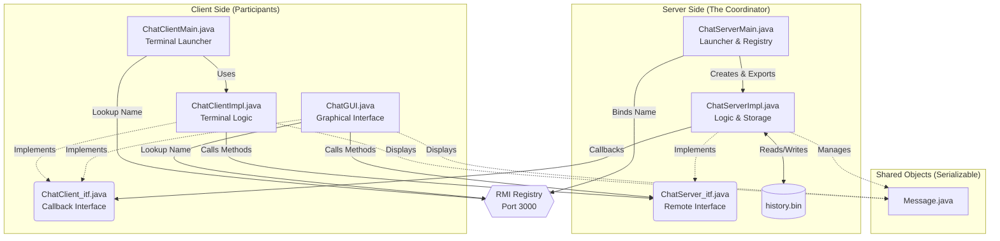

# Distributed Chat Application (Java RMI)
**Authors:** UMER Muhammad and GOMEZ ROSALES Laura Sofía
## Setup and Installation

### 1. Clone the Repository
```bash
git clone https://github.com/Slrosales/p_chat.git
cd p_chat
```

### 2. Prerequisites
*   Linux environment (Ubuntu recommended)
*   Java Development Kit (JDK 17+)
*   Port **3000** must be available
*   *Note: If you switch Java versions, delete `history.bin` to avoid `InvalidClassException`*

## Execution

### 1. Compilation
Use the provided build script to clean and compile the project:
```bash
chmod +x build.sh
./build.sh
```

### 2. Start the Server
Run the server script to initialize the RMI Registry and the Chat Service:
```bash
./run_server.sh
```

### 3. Start the Clients
You can run the client in two different modes:

**Terminal Mode:**
```bash
./run_client.sh <username>
```

**Graphical Mode (GUI):**
```bash
./run_gui.sh <username> [port]
# Or manually:
java -cp classes src.ChatGUI <username> localhost 3000
```

## Commands
*   **Client:** Type any text to send. Type `/leave` to exit gracefully.
*   **Server:** Type `/exit` or press `Ctrl+C` to stop (both trigger the persistence save).

## System Architecture 



### Client Side
*   **`ChatClientMain`**: Asks the Registry for the server and starts the terminal loop.
*   **`ChatClientImpl` / `ChatGUI`**: These classes decide how to show the message to the user (Temrinal or GUI).
*   **`ChatClient_itf`**: Defines how the server can "talk back" to the client (Receive Message).

### Server Side
*   **`ChatServerMain`**: Sets up the environment. It registers the server in the **RMI Registry**.
*   **`ChatServerImpl`**: This is where the **synchronized** lists live. It handles the `ArrayList` of messages and the `Map` of clients. It is the only file that touches **`history.bin`**.
*   **`ChatServer_itf`**: Defines what a client can ask the server to do (Join, Send, Leave).

### Message
 This is the only class that is **Serialized**. It travels from Client to Server and then to All Clients.
